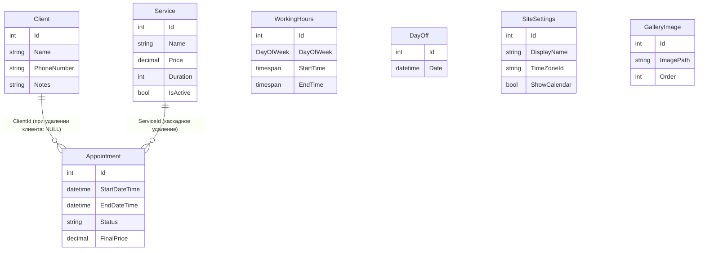

# MasterBooking

Веб-приложение для онлайн-записи и учёта клиентов частного мастера (в демо-данных это парикмахер): публичный сайт с услугами, работами и формой записи, а также закрытая админ-панель с записями, клиентами, услугами, финансовой статистикой и настройками сайта


## Возможности

**Публичная часть**

- страница мастера (`/m/{slug?}`) с описанием, активными услугами и галереей работ;
- страницы «Услуги», «Работы», «Контакты»;
- календарь занятого времени и форма записи (имя, телефон, дата и время).

**Админ-панель** (доступ только после входа)

- дашборд: количество записей на сегодня, выручка за месяц, средний чек, пять ближайших записей;
- записи: создание, редактирование, удаление с проверкой правил (см. ниже);
- клиенты и услуги: полный CRUD, у услуги есть цена, длительность и флаг активности;
- финансы (`/admin/finance`): доход за период, средний чек, доход по услугам (учитываются записи со статусом `Completed`);
- настройки сайта: имя, тема, основной цвет, логотип и обложка, галерея работ, «обо мне», телефон, соцсети, часовой пояс мастера.

**Правила записи** проверяет доменный сервис `AppointmentService`:

1. конец записи позже начала;
2. запись целиком в одном дне;
3. день не является выходным;
4. время входит в рабочие часы (у дня может быть несколько блоков, например с перерывом, но запись не должна попадать в «дырку» между ними);
5. запись не пересекается с другими (при редактировании запись не конфликтует сама с собой).

**Загрузка изображений** (`FileService`, SkiaSharp): только JPG/PNG/WebP до 5 МБ, изображение декодируется (так отсекаются файлы, которые только притворяются картинкой), уменьшается до 1920×1080 с сохранением пропорций, пережимается с качеством 85 и сохраняется под случайным GUID-именем.

**Часовые пояса:** время хранится в UTC, а день, месяц и «сегодня» для дашборда считаются в часовом поясе мастера из настроек.

## Стек

- ASP.NET Core 8, Razor Pages
- Entity Framework Core 8 + PostgreSQL (Npgsql), миграции применяются автоматически при старте
- ASP.NET Core Identity для входа
- SkiaSharp для обработки изображений
- Docker и Docker Compose (PostgreSQL 15)
- xUnit + Moq для тестов

## Архитектура

Решение разделено на три слоя плюс тесты. Домен ни от чего не зависит: репозитории и сервисы подключаются через интерфейсы.

```
src/
  MasterBooking.Domain          сущности, интерфейсы, бизнес-логика (AppointmentService, FinanceService)
  MasterBooking.Infrastructure  EF Core (DbContext, миграции, сид), AppointmentRepository, FileService
  MasterBooking.Web             Razor Pages, Program.cs, статические файлы
tests/
  MasterBooking.Domain.Tests    unit-тесты доменных сервисов
```

Зависимости направлены внутрь: `Web → Infrastructure → Domain`. Правила записи не знают про EF Core, поэтому их можно тестировать с подменой репозитория (`Mock<IAppointmentRepository>`).

### Модель данных



Сайт рассчитан на одного мастера: настройки сайта (`SiteSettings`) хранятся одной записью.

## Быстрый старт

### Через Docker

```bash
docker-compose up -d
```

Приложение будет доступно на [http://localhost:8080](http://localhost:8080). При первом запуске применяются миграции и база заполняется тестовыми данными (3 услуги, 2 клиента, рабочие часы пн-пт 9:00-18:00, 2 завершённые записи).

**Демо-доступ** (создаётся только в тестовых данных и нужен для локального запуска, в настоящем развёртывании используйте свои учётные данные):

- Email: `admin@demo.com`
- Пароль: `Password123!`

Полезные команды:

| Действие | Команда |
| --- | --- |
| Остановка | `docker-compose down` |
| Логи | `docker-compose logs -f` |
| Пересборка | `docker-compose up -d --build` |
| Полная очистка данных | `docker-compose down -v` |

### Локально, без Docker для приложения

Нужны .NET 8 SDK и Docker для базы.

```bash
docker-compose up -d db
dotnet run --project src/MasterBooking.Web
```

База доступна с хоста на порту `8432`, строка подключения лежит в `appsettings.Development.json`. Адрес приложения будет выведен в консоли (по умолчанию `http://localhost:2599`, настраивается в `launchSettings.json`).

## Тесты

```bash
dotnet test tests/MasterBooking.Domain.Tests
```

Сейчас 8 unit-тестов с подменой репозитория через Moq:

- `AppointmentService` (5): конец раньше начала, выходной день, время вне рабочих часов, пересечение с другой записью, корректная запись проходит;
- `FinanceService` (3): пустой период, сумма, средний чек и разбивка по услугам, отсутствие деления на ноль.

## Известные ограничения

- Форма записи на публичной странице пока использует первую услугу из списка и не проходит через `AppointmentService`, то есть правила из раздела «Правила записи» там не применяются.
- Загруженные изображения сохраняются в `wwwroot/uploads` внутри контейнера, отдельного тома для них в `docker-compose.yml` нет: после пересоздания контейнера они пропадут.
- Рабочие часы и выходные дни пока задаются только тестовыми данными или напрямую в базе: страниц для их редактирования в админ-панели нет.
- Удаление услуги каскадно удаляет все её записи, а значит и их вклад в финансовую статистику. Для «мягкого» скрытия есть флаг `IsActive`.
- Статусы записей (`Planned`, `New`, `Completed`, `Cancelled`) хранятся строками, а не перечислением.
- CI пока нет, тесты запускаются вручную.
- Тесты покрывают только доменный слой; репозиторий, страницы и загрузка файлов тестами не покрыты.
- Пароль базы данных в `docker-compose.yml` и `appsettings*.json` годится только для локального запуска.

## Планы

- [ ] прогонять публичную запись через `AppointmentService` и брать длительность выбранной услуги
- [ ] том для загруженных файлов в Docker Compose
- [ ] статусы записей в виде `enum`
- [ ] GitHub Actions: `dotnet build` и `dotnet test`
- [ ] интеграционные тесты репозитория на реальной PostgreSQL

## Лицензия

MIT, см. файл `LICENSE`.
